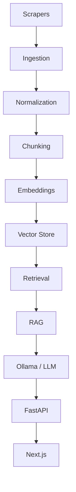

# BuildLearn AI Architecture

## Overview

The AI module is a layered RAG system designed to answer technical questions about construction products using trusted manufacturer documentation.

## Pipeline



## Layers

| Layer | Responsibility |
|-------|----------------|
| Scraping | Discover products and documents from manufacturer websites |
| Ingestion | Load HTML, PDF, and other raw documents |
| Normalization | Clean and normalize extracted text |
| Chunking | Split documents into retrievable chunks with metadata |
| Embeddings | Convert chunks to vectors via a configurable provider |
| Vector Store | Store and search vectors (Qdrant-first, pgvector-ready) |
| Retrieval | Fetch top-K relevant chunks with optional metadata filters |
| RAG | Build prompts with retrieved context and invoke the LLM |
| LLM | Generate answers via a configurable provider (Ollama-first) |
| API | Expose `/api/v1/ai/health` and `/api/v1/ai/chat` |

## Configuration

| Variable | Default | Purpose |
|----------|---------|---------|
| `AI_ENABLED` | `false` | Master switch for the AI module |
| `OLLAMA_BASE_URL` | `http://localhost:11434` | Ollama server URL |
| `OLLAMA_MODEL` | `qwen2.5` | LLM model name |
| `EMBEDDING_PROVIDER` | *(empty)* | Embedding provider identifier |
| `EMBEDDING_MODEL` | *(empty)* | Embedding model name |
| `VECTOR_STORE` | *(empty)* | Vector store identifier |
| `QDRANT_URL` | *(empty)* | Qdrant server URL |
| `QDRANT_COLLECTION` | `buildlearn_products` | Qdrant collection name |

## Model Separation

```
Coding Agent LLM     -> Ollama / Qwen2.5 (developer workstation)
Application LLM      -> Ollama / configurable via OLLAMA_MODEL
Embedding Model      -> Separate configurable provider / model
```

The coding agent's LLM is independent from the application's LLM and embedding model.

## Sources

- Gypsobat
- EMTOP Tunisie
- SOFAP Bâtiment

Scrapers are interfaces only in this phase. No aggressive crawling or bypassing of access controls is performed.
