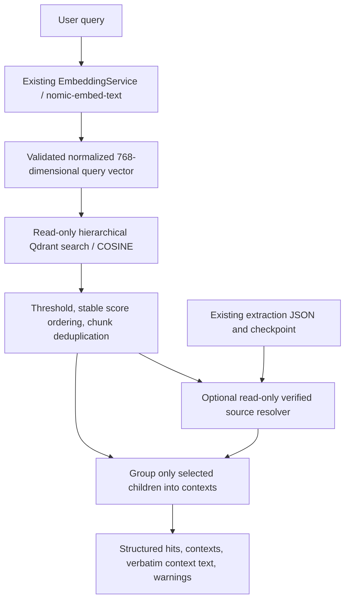

# Hierarchical retrieval architecture

## Scope

`HierarchicalRetriever` is a separate retrieval service for **`buildlearn_products_hierarchical_v1`**. It accepts a query and returns scored ChildChunk evidence, grouped context, and explicit warnings. It does not generate answers, call Qwen, register an API route, or change `/student/chat`.

Before implementation, the existing architecture, `retrieval/retriever.py`, `retrieval/filters.py`, `rag/retriever.py`, `rag/context_builder.py`, `EmbeddingService`, Qdrant provider, and their tests were inspected. The legacy retriever uses legacy `ChunkResponse` fields and configured `VectorStore`; its context builder can truncate text. Those implementations remain unchanged. The new service has its own result models and preserves hierarchical child text exactly.

## Flow



Qdrant calls are limited to `get_collection()` and `query_points()`, explicitly targeting the fixed hierarchical collection. There are no collection writes, repairs, deletes, creations, sibling searches, scrolls, or parent-point lookups. No production collection requests are made. Environment collection-name settings cannot redirect this service to `buildlearn_products`.

Before embedding/search, the service checks that the target collection has unnamed 768-dimensional COSINE vectors. Missing or incompatible collections fail; retrieval does not create them. A valid nonblank query is passed unchanged to `EmbeddingService.embed_single()`. The default service uses the existing `OllamaEmbeddingProvider` with `nomic-embed-text` and normalization enabled. Explicit incompatible provider/model/normalization settings are rejected; empty provider/model settings select the validated retrieval defaults without modifying global settings or `.env`.

Vectors must have 768 finite numeric values and L2 norm within `1e-5` of 1. Scores must be finite. Embedding or Qdrant failures propagate to the caller; no substitute results are fabricated.

## Public API and configuration

```python
from app.ai.retrieval.hierarchical_retriever import (
    HierarchicalRetriever,
    HierarchicalRetrievalConfig,
)

retriever = HierarchicalRetriever(
    config=HierarchicalRetrievalConfig(
        top_k=5,
        similarity_threshold=0.3,
        expand_parents=True,
        max_parent_chars=6000,
    ),
)
response = retriever.retrieve(
    "Quelle est la consommation de colle pour poser du carrelage ?",
    top_k=5,                      # optional per-query override
    similarity_threshold=0.3,    # optional per-query override
)
data = response.to_dict()
```

The constructor lazily creates the embedding service and Qdrant client. Tests can inject `embeddings`, `client`, and a trusted `context_resolver`. It is intentionally independent of legacy `BaseRetriever`/`ChunkResponse`, so existing callers are not silently switched to a different response shape.

| Setting | Default | Meaning |
|---|---:|---|
| `top_k` | 5 | Positive integer; maximum selected unique hits |
| `similarity_threshold` | 0.3 | Finite COSINE score cutoff from -1 to 1, inclusive |
| `expand_parents` | true | Attempt verified source parent/ancestor expansion |
| `max_parent_chars` | 6000 | Combined parent-text character budget per context; 0 omits parent text |

The service uses existing `ai_settings.qdrant_url` and `ai_settings.ollama_base_url`; `.env` loading remains the caller's responsibility. For this workstation, IPv4 loopback process environment values avoid the previously measured `localhost` connection delay:

```powershell
$env:QDRANT_URL = 'http://127.0.0.1:6333'
$env:OLLAMA_BASE_URL = 'http://127.0.0.1:11434'
```

No configuration file or existing provider behavior is changed. Boolean/non-integer top-K values and out-of-range/nonfinite thresholds are rejected before service calls.

## Structured results and exact text

`RetrievalResponse` contains:

- `hits`: ranked `RetrievedChild` records.
- `contexts`: grouped `RetrievedContext` records with selected-child fragments and available verified parent evidence.
- `context_text`: metadata headers and exact source text for convenient downstream consumption; no generation occurs.
- `warnings`: deterministic, deduplicated messages for unavailable or budget-omitted parent context.

Every hit exposes all requested fields: `chunk_id`, `score`, `text`, `document_id`, `file_name`, `source_path`, `parent_id`, `section_path`, `page_start`, `page_end`, and `block_type`. The payload's `chunk_id` is used, not Qdrant's integer/UUID point key. This supports existing hierarchical UUID overflow points without changing indexing or ID mappings.

Additional fields are `parent_id_path`, `parent_id_path_source`, and `payload_metadata`. `payload_metadata` is a deep copy of the complete original Qdrant payload, including unknown/nested fields. Required payload fields and types are validated. Missing text/identity, unknown block types, invalid page ranges, and invalid scores raise errors instead of being silently skipped.

Original child text is never trimmed, normalized, paraphrased, escaped in the rendered body, or truncated. There is no total-context character limit in this layer. The parent budget skips a whole parent text and reports the omission; child text is always retained. Parent text identical to an included child text is rendered once, while both structured evidence records remain available.

Context page ranges summarize the minimum known start and maximum known end of selected child chunks; they do not assert that every intervening page was retrieved. Each fragment and parent also preserves its own page metadata. Unknown page values remain unknown.

## Parent and ancestor reconstruction

The validated Qdrant payload has exactly ten fields. **It contains `parent_id` but does not contain parent text or `parent_id_path`.** ParentChunks themselves are not indexed in this collection. The service does not treat section labels as parent body text, infer ancestors from a section path, manufacture a document root, or use a child as an invented parent.

`ExtractionContextResolver` supplies optional authoritative evidence from the existing extraction JSON and successful indexing checkpoint, both read-only:

1. Verify checkpoint checksum, hierarchical target, dataset inventory identity, chunk configuration, and the existing chunking/embedding implementation fingerprint.
2. Select candidate extraction entries for the hit document ID, then disambiguate by exact `source_path`. Reused document IDs across different source documents remain separate.
3. Validate extraction file hashes/status and regenerate the existing `ChunkResult` with the unchanged default `HierarchicalChunker`.
4. Require the regenerated ordered child inventory to match the checkpoint, the hit ID to be successfully indexed, and every one of its ten payload fields to match the regenerated child exactly.
5. Read the matched source child's actual `parent_id_path` and resolve only its direct parent and listed ancestors from that source result. No additional ChildChunks are added to retrieval context.

Default sources:

```text
backend/ai_data/reports/full_extraction/
backend/ai_data/indexing/hierarchical_index_checkpoint.json
```

The resolver has no persistent cache or writes. It regenerates each selected source document once per request; siblings may exist in the in-memory source ChunkResult for integrity verification, but are not fetched from Qdrant or included as retrieved child evidence. Only selected hits and explicitly resolved ParentChunk text enter context.

If files/checkpoint are missing, corrupt, changed, ambiguous, or do not match the hit, search hits still return unchanged with `Parent context unavailable` warnings. No guessed parent text is substituted. Setting `expand_parents=False` avoids source resolution entirely.

When an optional payload `parent_id_path` exists, it is preserved with source marker `payload`. When absent, it remains `None`/`unavailable` unless the verified source child supplies a real path, marked `verified_source_child`. Current validated source children have an empty ancestor path, so successful source resolution can establish `[]`; it does not create additional ancestry. The 239 parentless roots remain parentless, consistent with the audit.

Parent evidence must belong to the retrieved document/source/file and an explicitly listed ancestor or direct parent. Mismatched or contradictory injected parent evidence is rejected. Injected context resolvers are trusted evidence providers and must meet the same non-invention contract as the default resolver.

## Ordering, deduplication, and bounded expansion

Qdrant receives `limit=top_k` and `score_threshold=...`. The service also applies the threshold locally, including exact boundary scores, then sorts by descending score with `(document_id, source_path, chunk_id)` tie-breaks. There is one similarity query and no automatic over-fetch/refill; thresholding and deduplication may return fewer than K hits.

Repeated `(document_id, source_path, chunk_id)` hits retain the highest score. Different payloads for the same identity raise an error. Identical text from different source documents is retained. Distinct chunk IDs remain in `hits`, even when their exact texts repeat.

Contexts are grouped by source identity, file, direct parent, section path, and known ancestor path. Parentless chunks also require matching page location; parentless chunks with entirely unknown page locations remain separate. Context group order follows the best ranked contributing hit.

Within a context, fragments sort by known pages and chunk ID for deterministic ordering. This is not a claim of original within-page reading order, which is absent from the Qdrant payload. Identical text/type/page fragments are rendered once with all contributing `chunk_ids`; distinct locations remain separate structured fragments. Exact duplicate text strings in the same rendered context are displayed once, with provenance retained in the structured records. Parent evidence is deduplicated by ID and checked for conflicting content.

There is no retrieval of every sibling sharing a parent. A parent's verified full original text can itself contain more material than a matched child; the parent character budget limits this expansion without truncation. The context has no additional synthetic content beyond clearly separate provenance metadata headers.

## Added files

- `backend/app/ai/retrieval/hierarchical_models.py`
- `backend/app/ai/retrieval/hierarchical_retriever.py`
- `backend/app/ai/retrieval/source_context.py`
- `backend/tests/ai/test_hierarchical_retriever.py`
- `docs/ai/RETRIEVAL_ARCHITECTURE.md`

No existing production code or validated-stage file was edited. Legacy retrieval, context builder, endpoints, extraction, chunking, embeddings, indexing/checkpoint files, and Qdrant provider behavior remain unchanged.

A before/after SHA-256 inventory covered 3,098 protected files. The running Qdrant server appended two access-log entries to `backend/ai_data/indexing/qdrant_stdout.log` for the smoke test's collection-info GET and similarity query POST. Removing those two appended lines **in memory only** reproduces the exact pre-change inventory digest (`11fbbc9ff8c32a7d7e33b5f0380ef819e4c20b8331df5c6701a4f1a1ced4b8c6`), confirming every other protected file is unchanged. No log was restored or edited, and no collection write API was called.

## Executed verification

| Execution | Result |
|---|---|
| Pre-change existing retrieval/context/embedding/vectorstore selection | 76 passed |
| New mocked tests before the final unknown-page case | 72 passed |
| Final relevant regression selection, including all 73 new tests | **334 passed, 0 failures, 0 collection errors** |
| Separate live read-only smoke query | 5 ranked hits, 5 contexts, 5 verified parent contexts, no warnings; all original child text preserved |

The live query was `Quelle est la consommation de colle pour poser du carrelage ?`. Scores were `0.7608206`, `0.7599277`, `0.7558687`, `0.74933404`, and `0.74933404`. Hit IDs were `83b1536692c10703`, `00a464bde031d6cf`, `4d02781e07590fd1`, `86cad08e31e08886`, and `c7ba0fe73e1a658f`. Every ancestor-path source was `verified_source_child`. No Qwen/LLM call was performed.

The new tests mock embeddings and Qdrant. Local-source tests create temporary fixture extraction/checkpoint files outside the actual indexing data and verify that the resolver does not change them. Tests cover query embedding, configurable top-K/threshold, score/tie ordering, exact payload and metadata preservation, parent/ancestor expansion, repeated contexts and text, source separation, roots, unavailable/changed evidence, corruption, parent budgets, empty results, vector/schema validation, service failures, and production isolation.

Final relevant test command, run from `backend`:

```powershell
.\venv\Scripts\python.exe -B -m pytest tests/ai/test_retriever.py tests/ai/test_context_builder.py tests/ai/test_embeddings.py tests/ai/test_vectorstore.py tests/ai/test_hierarchical_retriever.py tests/ai/test_hierarchical_indexer.py tests/ai/test_hierarchical_pipeline.py tests/ai/test_technical_chunker.py tests/ai/test_hierarchical_chunker.py tests/ai/test_rag_service.py tests/ai/test_llm_provider.py tests/ai/rag -q -p no:cacheprovider --basetemp C:\Users\user\Desktop\stage\.tmp\retrieval_05 --tb=short
```

The initial new-test run had 47 passes and nine temporary-directory setup errors because the requested base directory's parent did not exist. After creating the workspace temporary parent, all tests passed. No indexing-data directory was used for new test output. The final suite reported 1,824 existing `datetime.utcnow()`/pytest fixture deprecation warnings; those protected implementations were not modified.

This is a focused relevant regression run, not a claim that every unrelated legacy AI test or dependency is healthy. Retrieval effectiveness across a labeled query dataset and threshold calibration were not evaluated. Only the smoke query above was run against live services; the unit suite has no live-service dependency.
