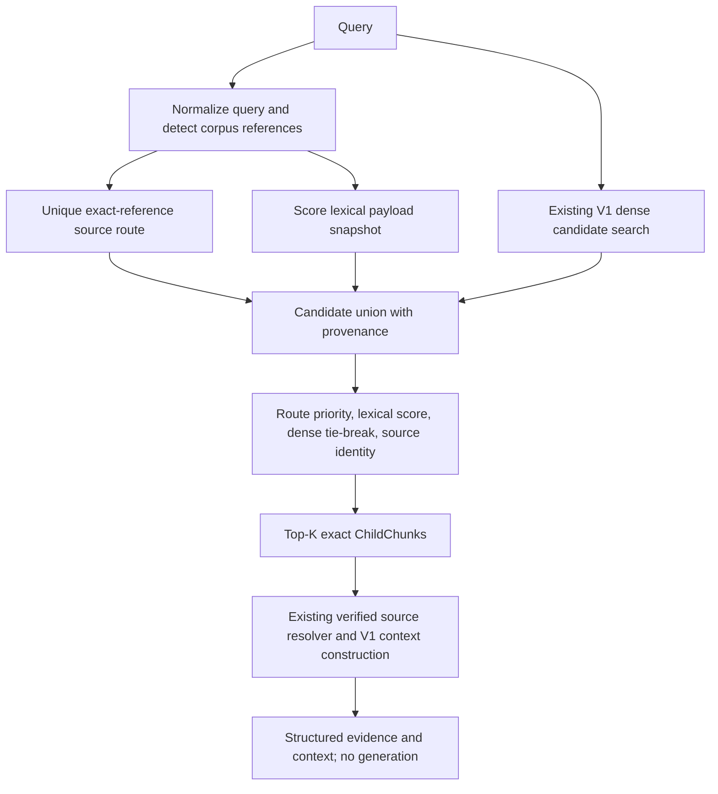

# Retrieval V2 architecture

V2 is an independent read-only service in `backend/app/ai/retrieval/retrieval_v2.py`. V1, extraction, chunking, embeddings, indexing, existing payloads/vectors, RAG, Qwen and `/student/chat` are unchanged. There is no endpoint integration, deployment, LLM generation or automatic collection creation. The sole collection is `buildlearn_products_hierarchical_v1`.

## Architecture and frozen decision



Diagnostics showed missing dense candidates, strong lexical retrieval, and references appearing only in filename metadata. Equal-weight fusion performed poorly, so V2 uses lexical-first ordering. There are no held-out-trained coefficients: lexical feature sum follows the diagnostic lexical control, unique source routing takes priority, and dense COSINE is used only as a tie-break. The implementation and default configuration were hashed before held-out labels were created; the evaluation rejects modifications after that freeze. Measured held-out results are in `RETRIEVAL_V2_EVALUATION.md`.

## Query analysis and identifiers

Reference syntax is corpus-derived: token boundaries, 2–8 letters followed by a digit-led 3–12-character alphanumeric suffix containing at least three digits. References must occur in URL-decoded source filenames. No evaluation-specific identifier is hardcoded.

Query analysis reports known and unknown syntactic references. Routing requires exactly one source in the intersection of known-reference source sets and no unknown references. Missing, ambiguous, conflicting or partially unknown references do not trigger a restrictive route; global lexical/dense search still runs. All-letter product names and unsupported reference formats are lexical signals. An unknown standard-shaped token can conservatively suppress routing. No source or parent is inferred from an identifier alone.

Source identity is `(document_id, file_name, source_path)`, and candidate identity adds `chunk_id`. This preserves separate sources even when document IDs collide or boilerplate repeats across documents.

## Lexical snapshot and normalization

On first retrieval, `refresh()` reads collection configuration and scrolls its child payloads with `with_vectors=False`. It verifies unnamed 768-dimensional COSINE vectors and validates every payload using the existing V1 schema validator. Duplicate identities with contradictory payloads fail. Only a successfully built snapshot replaces the current in-memory snapshot. No persistent lexical index, checkpoint, collection field or dependency is added.

Normalization operates on scoring copies: URL decoding, Unicode NFKD, accent removal, ligature expansion and casefolding. Tokens preserve alphanumeric references and exact integer/decimal values. Decimal comma and decimal dot remain distinct spellings. Original child text, filename, source path and payload metadata are never rewritten.

Each candidate has four transparent features:

| Feature | Definition |
|---|---|
| Identifier match | Boolean exact recognized-reference token match in child text or filename |
| Filename match | Fraction of non-stopword query word/reference tokens found in decoded filename |
| Numeric match | Fraction of exact query numeric tokens found in child text or filename |
| Word match | Query-normalized IDF-weighted word/reference overlap with child text plus filename |

IDF is `log((N+1)/(df+1))+1` over unique child identities. Unseen query words contribute to the denominator. A minimal normalized French stopword list excludes common words from word/filename overlap. `lexical_score` is the sum of the four features, with no trained weights. Zero lexical scores do not generate lexical candidates. Lexical ranks are computed across the entire snapshot, including candidates admitted only by another branch.

## Candidate budgets, union and ordering

Defaults frozen before held-out evaluation:

| Configuration | Default |
|---|---:|
| `top_k` | 5 |
| `lexical_candidates` | 50 |
| `dense_candidates` | 100 |
| `expand_parents` | true |
| `max_parent_chars` | 6000 |

Global lexical candidates take the first configured number of positive-score records. A unique identifier route adds up to the same lexical budget from that source; it does not fetch siblings by parent. Dense candidates use the unchanged V1 path with COSINE threshold 0.0 and parent expansion disabled. The union is bounded by `2 * lexical_candidates + dense_candidates`, usually fewer because branches overlap. Final hits may be fewer than K when there are fewer distinct candidates; no over-fetch/refill occurs.

Dense payloads must match the lexical snapshot exactly. Unknown or changed dense records raise an explicit stale-snapshot error requiring `refresh()`. This check covers dense-returned records; lexical-only changes are not detected automatically. The service assumes the validated corpus is immutable between refreshes, as in this task. No transactional collection snapshot or automatic continuous synchronization is claimed.

Final ordering is deterministic:

1. Candidates belonging to a unique identifier route.
2. Descending lexical score.
3. Descending dense COSINE score, with missing dense scores after known scores.
4. Source/chunk identity as the final tie-break.

Dense evidence never overrides a strict lexical-score difference. This is deliberate lexical-first behavior rather than equal-weight reciprocal-rank fusion. Held-out results measure its contribution instead of assuming the dense branch is beneficial.

## Response and provenance

`V2Child` extends the existing child result fields. `V2Response` extends the existing response with the complete ranked candidate union and query analysis. Its `to_dict()` serializes hits, contexts, candidates, warnings and analysis.

Every union candidate retains:

- Original chunk/document/file/source IDs, exact text, hierarchy fields, section path, pages, block type and a detached copy of complete original payload metadata.
- `dense_score` and `dense_rank`, null when absent from the dense pool.
- `lexical_score` and full-snapshot `lexical_rank`.
- `identifier_match`, `filename_match`, `numeric_match`, and `word_match`.
- Sorted `candidate_sources`: `lexical`, `identifier_route`, and/or `dense`.
- `identifier_route`, identifying actual route-source priority separately from a token match.

`score` equals `lexical_score`; it is not COSINE similarity, a probability or the complete ordering tuple. Consumers must use returned order rather than sorting by `score`. `dense_score` is the field for COSINE similarity. V1 scores keep their original meaning. The returned candidate objects and selected hits are detached from the cached payload snapshot; consumer mutation cannot alter subsequent retrievals.

## Verified parent expansion

Only final top-K children are passed to the unchanged extraction/checkpoint-backed source resolver. V2 reuses V1's `_contexts` method, including source/hierarchy checks, deterministic context grouping, text deduplication and the parent character budget. Missing or changed source evidence produces warnings and raw child results; no parent text is invented. Full child text is retained without truncation. Parent expansion does not alter ranking or retrieve every sibling.

The shared methods/resolver are currently private V1 interfaces. This coupling is intentional to keep V1 unchanged and reuse its validated behavior; regression tests protect it. Candidate records describe pre-expansion provenance, while final hits may additionally contain a verified ancestor path. Context rendering preserves exact parent/child body strings and separates metadata headers from source text.

## Usage and comparison modes

```python
from app.ai.retrieval.retrieval_v2 import RetrievalV2, RetrievalV2Config

retriever = RetrievalV2(config=RetrievalV2Config(
    lexical_candidates=50,
    dense_candidates=100,
    top_k=5,
))
result = retriever.retrieve("Quel couple maximal offre ECIDL208689 ?", top_k=3)
structured = result.to_dict()
```

The default client uses existing Qdrant settings; query embedding goes through existing V1/EmbeddingService/nomic-embed-text. Tests and evaluation inject clients and embedding services. Configuration remains local to V2; existing settings/default files are unchanged.

`mode="lexical"` uses global lexical candidates with no source-route priority or dense calls. It still recognizes references as lexical tokens/features. `mode="identifier_lexical"` adds unique source routing, with global lexical fallback. `mode="v2"` adds dense candidates and their tie-break/provenance. All modes can perform verified parent expansion after selection; lexical modes never call embeddings.

## Validation and limitations

The relevant regression suite passed **374 tests**, including **19 new offline V2 tests**. Coverage includes conservative routing, ambiguous/unknown references, Unicode normalization, exact decimals, URL decoding, union/deduplication, source memberships and ranks, lexical-first ordering and dense tie-breaks, exact text/metadata preservation and detachment, selected-only parent expansion, unavailable-parent handling, collection isolation, configurable budgets, empty lexical results, schema conflicts, vector configuration and stale snapshots. There were 1,824 existing datetime/fixture deprecation warnings; no test failures.

The live held-out evaluation verified unchanged collection payload/vector digest and protected pipeline hashes. Twenty previously unused source files supplied the new labeled questions. Implementation hash was checked against the pre-label freeze, and no post-evaluation tuning occurred. Zero parent warnings occurred. Detailed subset metrics and actual returned evidence appear in the evaluation report.

This in-memory lexical scan is appropriate for the current 2,637 children, but loads all payload text and scores the corpus per query. It has no external lexical index, language stemming, synonyms, approximate-number matching, trained reranker or abstention calibration. Corpus refresh is explicit. This task adds a reviewable separate path; adoption, API wiring and generation remain separate decisions.

Added files: V2 service, `backend/tests/ai/test_retrieval_v2.py`, `backend/tests/ai/fixtures/retrieval_v2_heldout.json`, `backend/scripts/evaluate_retrieval_v2.py`, and the two substantial V2 reports. No existing production component or old report was changed.


## Manual-testing follow-up: product overviews (2026-09-27)

After the academic freeze, the user explicitly enabled V2 for local student chat and authorized evidence-selection changes for broad product questions. The architecture and evaluation above describe the earlier frozen snapshot; its held-out scores are not newly measured scores for this follow-up. Historical evaluation artifacts and the submission knowledge pack remain unchanged.

The PAP2 manual case exposed two separate gaps. Its full `LIKA PAP2` title is repeated on adjacent nonempty lines, but its filename contains only the variant. The identity builder now recognizes this bounded, uppercase full-title pattern with an exact filename-token suffix. Filename-only/body-only matches, conflicting titles and unknown variants remain rejected. Rebuilding the identity sidecar changed only the two PAP2 source records: 201 mapped records, 20 quarantined records, 193 canonical products. Qdrant payloads/vectors and extraction/checkpoints were not changed.

The endpoint injects the existing canonical resolver into Retrieval V2. For broad characteristics/specifications requests resolving to exactly one product, the retriever adds up to the existing lexical candidate limit of verified-owned children from its read-only snapshot. It prefers explicit numeric technical facts, then specification sections, using transparent categorical priorities. Clear original facts precede excerpts containing an OCR replacement character or an ambiguous formula marker. No source text is corrected. The final selection suppresses exact repeated text/page/section copies within that same verified identity, so duplicate PDFs do not consume multiple top-K slots.

Specific numeric/compatibility requests, unresolved identities and comparisons retain the ordinary retrieval path. V1 is unchanged. Dense/lexical counts and top-K are unchanged; the overview branch has its own existing lexical-limit bound, like identifier routing. The candidate union retains original dense/lexical scores/ranks, plus `product_overview` membership, `product_overview_match` and `overview_priority`; selected-source private provenance preserves the added signals. Only final selected children and their existing verified parents reach generation and the support whitelist. The model, prompts, generation settings, support-ID/extractive validator, product/conflict validator and requested-fact validator are unchanged.

The exact French manual question `Quelles sont les caract?ristiques de Lika PAP2 ?` now returns three validated extracts: flexion/compression resistance, natural-gypsum purity, and B7/50/6 classification/fire reaction A1. Each public citation belongs to `fiche_technique_pap2.pdf`; the unknown variant `LIKA PAP2 PLUS` still abstains with no public sources. This is a focused manual regression, not an independent acceptance campaign or proof that every property on the sheet is covered. Corrupted/split fields remain subject to the unchanged strict validators.

Validation: **610 relevant tests passed**, 1,847 existing warnings, 10.88 s. Coverage includes duplicate-aware overview selection, deterministic ordering, metadata/exact text, source isolation, ambiguous/comparison exclusion, ordinary-query preservation, prior identity and safety regressions, runtime/API integration and hierarchical pipeline tests. Both collections' complete ID/payload/vector digests still match their previously verified values, and 252 immutable pipeline/extraction/index/checkpoint file hashes match the historical baseline. No Qdrant write or indexing operation was performed. Restart the backend after the sidecar/code update to discard an older initialized resolver.
